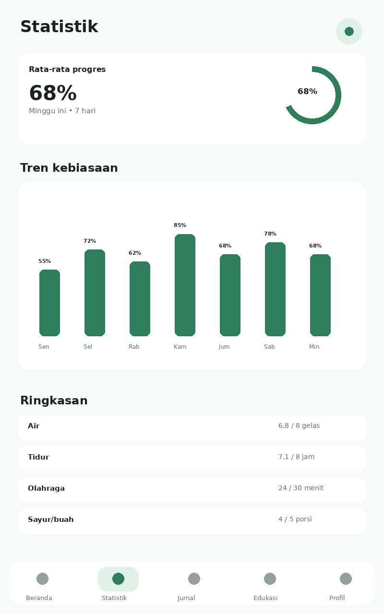
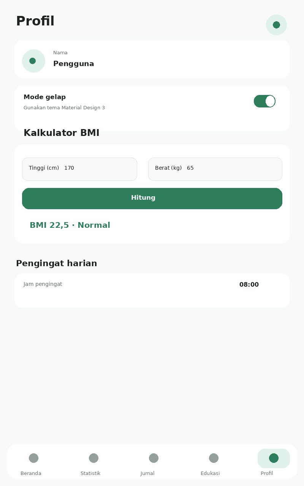
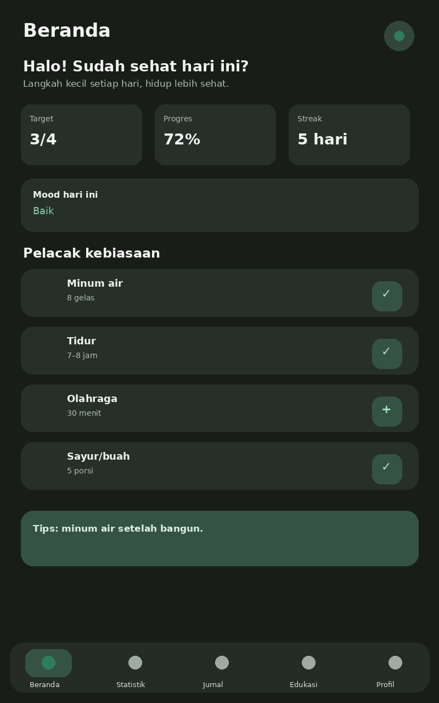

# SehatKu 🌿

**Pendamping kebiasaan sehat harian** — proyek aplikasi mobile Flutter 

> **Kelompok:** Endless  
> **Anggota:** Wesley (241111300) Michael (241112834)

## 1.📄 Ringkasan proyek

SehatKu adalah aplikasi mobile berbasis Flutter yang dirancang untuk membantu pengguna membangun dan mempertahankan kebiasaan hidup sehat melalui pencatatan kebiasaan harian, pemantauan progres, refleksi suasana hati, kalkulator BMI, edukasi kesehatan, serta pengaturan profil dan pengingat.

Aplikasi ini dibuat sebagai proyek kelompok untuk menerapkan materi pengembangan aplikasi Flutter, khususnya widget dasar, layout, Material Design 3, reusable widget, asset, struktur project Flutter, dan responsive UI.

## 2.📊 Fitur yang sudah diimplementasikan

- Dashboard: target, progres, streak, mood, tips harian.
- Pelacak kebiasaan: air, tidur, olahraga, sayur/buah dengan tombol tambah/check.
- Statistik mingguan: ringkasan dan grafik progres 7 hari.
- Jurnal mood: pilihan suasana hati, catatan, dan riwayat.
- Kalkulator BMI: input tinggi/berat dan kategori BMI.
- Edukasi kesehatan: artikel singkat dan pencarian.
- Profil & pengingat: nama, jam pengingat, pengaturan profil.
- Mode gelap: Material Design 3 light/dark theme.
- Responsive UI: menggunakan layout Flutter yang dapat beradaptasi pada ukuran layar.

## 3. 📸 Tampilan aplikasi

Preview berikut dibuat sebagai dokumentasi tampilan halaman berdasarkan implementasi Flutter di `lib/main.dart`.

### Beranda

### Statistik

### Jurnal Mood

### Edukasi

### Profil & BMI

### Mode Gelap

3. Target Pengguna

Aplikasi ditujukan terutama untuk generasi muda, yaitu:

Pelajar — 15–18 tahun

Membantu membangun kebiasaan sehat sejak dini.

Mahasiswa — 18–25 tahun

Membantu pengguna yang memiliki jadwal padat, sering begadang, atau melewatkan waktu makan.

Pekerja muda — 25–30 tahun

Memberikan pengingat dan pencatatan sederhana yang dapat digunakan di sela aktivitas.

────────

## 4. 💡 Tujuan Aplikasi

Tujuan Umum

Mendukung SDG 3 dengan membantu generasi muda menjalani pola hidup yang lebih sehat melalui aplikasi mobile yang sederhana, menarik, dan menggunakan bahasa Indonesia.

Tujuan Khusus

1. Membantu pengguna mencatat kebiasaan sehat harian dengan cepat.
2. Membantu pengguna melihat perkembangan kebiasaan selama beberapa hari.
3. Membantu pengguna melakukan refleksi terhadap suasana hati.
4. Memberikan kalkulator BMI sebagai informasi tambahan mengenai indeks massa tubuh.
5. Memberikan artikel edukasi kesehatan yang singkat dan mudah dipahami.
6. Membantu pengguna membangun konsistensi melalui target, progres, streak, dan pengingat.
7. Menyediakan tampilan terang dan gelap agar aplikasi lebih nyaman digunakan.

────────

## 5. ✨ Fitur Utama

5.1 🏠 Dashboard / Beranda

Dashboard merupakan halaman utama yang memberikan gambaran singkat mengenai kondisi aktivitas pengguna.

Informasi yang ditampilkan meliputi:

* Sapaan pengguna.
* Target kebiasaan harian.
* Persentase progres.
* Streak atau jumlah hari konsisten.
* Mood pengguna.
* Ringkasan kebiasaan.
* Tips kesehatan harian.

Tujuannya adalah agar pengguna dapat mengetahui kondisi progres mereka tanpa harus membuka banyak halaman.

────────

5.2 💧 Pelacak Kebiasaan

Fitur pelacak kebiasaan digunakan untuk mencatat empat kebiasaan utama:

* Minum air
* Tidur
* Olahraga
* Konsumsi sayur/buah

Pengguna dapat melakukan pencatatan secara sederhana melalui kontrol pada halaman tracker. Setelah pencatatan dilakukan, progres akan digunakan untuk memberikan gambaran perkembangan kebiasaan pengguna.

────────

5.3 📊 Statistik Mingguan

Halaman statistik digunakan untuk melihat perkembangan kebiasaan secara lebih terstruktur.

Fitur ini menyediakan:

* Ringkasan progres.
* Grafik perkembangan.
* Data 7 hari.
* Persentase rata-rata progres.
* Pilihan tampilan periode statistik.

Tujuannya adalah membantu pengguna mengetahui pola kebiasaan dan melihat apakah terdapat peningkatan dari waktu ke waktu.

────────

5.4 😊 Jurnal Suasana Hati

Fitur jurnal mood digunakan untuk melakukan refleksi sederhana terhadap kondisi pengguna.

Pengguna dapat:

* Memilih suasana hati.
* Menuliskan catatan singkat.
* Menyimpan jurnal.
* Melihat catatan yang telah dibuat.

Fitur ini melengkapi pencatatan kebiasaan fisik dengan aspek refleksi diri.

────────

5.5 ⚖️ Kalkulator BMI

Kalkulator BMI memungkinkan pengguna memasukkan:

* Tinggi badan dalam sentimeter.
* Berat badan dalam kilogram.

Aplikasi kemudian menghitung nilai BMI dan menampilkan kategorinya.

Contoh pada rancangan aplikasi:

Tinggi : 170 cm
Berat  : 65 kg
BMI    : 22,5
Kategori: Normal

Fitur ini digunakan sebagai informasi umum mengenai indeks massa tubuh dan bukan sebagai alat diagnosis medis.

────────

5.6 📚 Edukasi Kesehatan

Halaman edukasi menyediakan artikel singkat yang berkaitan dengan kebiasaan hidup sehat.

Contoh topik:

* Pentingnya hidrasi.
* Tidur berkualitas.
* Aktif bergerak.
* Gizi seimbang.

Tersedia juga pencarian artikel agar pengguna dapat menemukan topik yang dibutuhkan dengan lebih cepat.

────────

5.7 👤 Profil dan Pengingat

Halaman profil digunakan untuk mengatur informasi dasar pengguna dan pengaturan aplikasi.

Fitur yang disediakan antara lain:

* Mengatur nama pengguna.
* Mengaktifkan pengingat harian.
* Mengatur waktu pengingat.
* Menyimpan pengaturan profil.

Pengingat dirancang untuk membantu pengguna menjaga konsistensi dalam melakukan kebiasaan sehat.

────────

5.8 🌙 Mode Gelap

SehatKu menyediakan Light Mode dan Dark Mode menggunakan pendekatan Material Design 3.

Pengguna dapat mengganti tema melalui pengaturan sehingga tampilan dapat disesuaikan dengan kondisi penggunaan dan preferensi pengguna.

────────

## 6. 🔄 Alur Penggunaan Aplikasi

Secara umum, alur penggunaan SehatKu adalah sebagai berikut:

                MULAI
                  │
                  ▼
          ┌─────────────────┐
          │    Beranda      │
          └────────┬────────┘
                   │
       ┌───────────┼────────────┐
       ▼           ▼            ▼
   Pelacak      Statistik     Jurnal
   Kebiasaan     7 Hari        Mood
       │           │            │
       └───────────┼────────────┘
                   │
          ┌────────┴────────┐
          ▼                 ▼
        Edukasi          Profil
          │                 │
          │          ┌──────┴──────┐
          │          ▼             ▼
          │       Pengingat    Dark Mode
          │
          └─────────┐
                    ▼
               Kalkulator BMI

Alur tersebut menunjukkan bahwa pengguna dapat memulai dari dashboard kemudian berpindah ke fitur sesuai kebutuhan.

────────

## 7. 🖼️ Dokumentasi Tampilan Aplikasi

Berikut merupakan dokumentasi tampilan halaman yang dibuat untuk project SehatKu.

7.1 Beranda

Halaman beranda menampilkan ringkasan target, progres, streak, mood, kebiasaan, serta tips kesehatan.

Beranda

────────

7.2 Statistik

Halaman statistik menampilkan perkembangan kebiasaan dan grafik progres untuk membantu pengguna melihat tren selama beberapa hari.

Statistik

────────

7.3 Jurnal Suasana Hati

Halaman jurnal memungkinkan pengguna memilih mood dan menambahkan catatan singkat mengenai kondisi hari tersebut.

Jurnal Mood

────────

7.4 Edukasi Kesehatan

Halaman edukasi berisi kumpulan artikel singkat mengenai kebiasaan hidup sehat dan menyediakan fitur pencarian.

Edukasi

────────

7.5 Profil dan Pengaturan

Halaman profil digunakan untuk mengatur informasi pengguna, pengingat, dan pengaturan aplikasi.

Profil

────────

7.6 Mode Gelap

Tampilan dark mode merupakan alternatif tema yang dapat dipilih melalui pengaturan aplikasi.

Dark Mode

────────

## 8. 🛠️ Teknologi yang Digunakan

Project dikembangkan menggunakan:

* Flutter — framework pengembangan aplikasi mobile.
* Dart — bahasa pemrograman yang digunakan Flutter.
* Material Design 3 — sistem desain antarmuka.
* Responsive Layout — agar tampilan dapat menyesuaikan ukuran layar.
* Flutter Widgets — untuk membangun komponen antarmuka dan interaksi aplikasi.

Project ini dibuat tanpa state-management package eksternal sehingga struktur implementasi tetap sederhana dan mudah dipelajari untuk kebutuhan tugas front-end Flutter.

────────

## 9. 🗂️ Struktur Project

sehatku_flutter/
│
├── assets/
│   └── screenshots/
│       ├── 01_beranda.png
│       ├── 02_statistik.png
│       ├── 03_jurnal.png
│       ├── 04_edukasi.png
│       ├── 05_profil.png
│       └── 06_dark_mode.png
│
├── lib/
│   └── main.dart
│
├── analysis_options.yaml
├── pubspec.yaml
├── .gitignore
└── README.md

File utama aplikasi berada pada:

lib/main.dart

Sedangkan gambar dokumentasi halaman aplikasi berada pada:

assets/screenshots/

────────

## 10. 🚀 Cara Menjalankan Project

Persyaratan

Pastikan perangkat telah memiliki:

* Flutter SDK.
* Dart SDK yang tersedia melalui Flutter.
* Android Studio/Android SDK atau perangkat target lainnya.
* Visual Studio Code (opsional tetapi direkomendasikan).

Instalasi dependency

Buka terminal pada folder project kemudian jalankan:

flutter pub get

Mengecek perangkat

flutter devices

Menjalankan aplikasi

flutter run

Jika ingin menjalankan pada Chrome dan perangkat web tersedia:

flutter run -d chrome

────────

## 11. 🧪 Pengujian dan Demo

Beberapa hal yang dapat didemonstrasikan saat presentasi adalah:

1. Membuka halaman Beranda.
2. Melakukan pencatatan pada habit tracker.
3. Melihat perubahan progres.
4. Membuka halaman Statistik.
5. Membuat jurnal mood.
6. Menggunakan kalkulator BMI.
7. Mencari artikel pada halaman Edukasi.
8. Mengatur nama dan pengingat pada Profil.
9. Mengaktifkan Dark Mode.
10. Menunjukkan bahwa tampilan menggunakan Material Design 3 dan layout Flutter.

────────

## 12. 📚 Kesesuaian dengan Materi Perkuliahan

Project ini dibuat untuk menerapkan beberapa materi Flutter yang dipersyaratkan dalam tugas, antara lain:

* Widget dasar untuk membangun elemen UI.
* Layout single-child dan multi-child sesuai kebutuhan tampilan.
* Material Design 3 melalui tema dan komponen Flutter.
* Reusable widget agar komponen antarmuka dapat digunakan kembali.
* Asset untuk dokumentasi gambar tampilan.
* Responsive UI agar layout dapat beradaptasi terhadap ukuran layar.
* Struktur project Flutter yang terorganisasi.
* Dart sebagai bahasa pemrograman utama.

Selain implementasi UI, mahasiswa juga diharapkan memahami kode yang digunakan, mampu memodifikasi kode, melakukan pengujian, serta menjelaskan bagian implementasi saat demo.

────────

## 13. 🤖 Penggunaan AI / Vibecoding

Dalam proses pengembangan, AI/vibecoding dapat digunakan sebagai alat bantu pemrograman, bukan sebagai pengganti pemahaman mahasiswa terhadap kode.

Penggunaan AI dapat membantu dalam:

* Menyusun struktur awal kode.
* Memberikan contoh implementasi widget Flutter.
* Membantu mencari alternatif solusi ketika terjadi error.
* Membantu memperbaiki dan merapikan kode.
* Memberikan ide untuk responsive layout dan reusable widget.

Setiap kode yang digunakan tetap perlu dipahami, diperiksa, dimodifikasi jika diperlukan, dan diuji oleh anggota kelompok. Hal ini penting karena pada saat demo setiap anggota harus mampu menjelaskan bagian kode yang menjadi tanggung jawabnya.

────────

## 14. 👨‍💻 Pembagian Tugas Kelompok

Pembagian tugas dibuat agar kedua anggota memiliki kontribusi dalam proses analisis, desain, implementasi, dan dokumentasi.

Wesley — 241111300

Fokus kontribusi:

* Analisis permasalahan yang berkaitan dengan SDG 3.
* Penyusunan konsep solusi aplikasi.
* Struktur project Flutter.
* Implementasi dan pengembangan bagian aplikasi sesuai pembagian kerja kelompok.
* Membantu pengujian dan dokumentasi project.

Michael — 241112834

Fokus kontribusi:

* Perancangan UI dan alur halaman.
* Implementasi dashboard dan habit tracker.
* Implementasi fitur pendukung sesuai pembagian kerja kelompok.
* Membantu pengujian responsive UI dan dokumentasi project.

> Pembagian di atas merupakan ringkasan untuk dokumentasi repository. Rincian pekerjaan berdasarkan minggu dicatat pada file Logbook kelompok.

────────

15. ⚠️ Catatan Implementasi

Versi project ini berfokus pada implementasi front-end dan interaksi dasar aplikasi sesuai ruang lingkup tugas.

Data pada versi ini bersifat in-memory, sehingga data dapat kembali ke kondisi awal ketika aplikasi dihentikan atau dimulai kembali. Penyimpanan permanen seperti database lokal/cloud dapat ditambahkan pada pengembangan berikutnya.

Fitur pengingat pada versi tugas merupakan bagian dari rancangan antarmuka dan pengaturan aplikasi. Implementasi notifikasi background permanen dapat dikembangkan lebih lanjut menggunakan mekanisme notifikasi lokal.

────────

## 16. 🔮 Pengembangan Selanjutnya

Jika aplikasi dikembangkan lebih lanjut, beberapa peningkatan yang dapat dilakukan adalah:

* Penyimpanan data menggunakan database lokal.
* Sinkronisasi data dengan cloud.
* Notifikasi pengingat yang berjalan di background.
* Sistem akun/login pengguna.
* Grafik statistik yang lebih lengkap.
* Riwayat kebiasaan dalam periode yang lebih panjang.
* Konten edukasi yang lebih banyak.
* Pengujian otomatis/unit test dan widget test.

Pengembangan tersebut berada di luar fokus utama implementasi front-end pada project tugas ini.

────────

## 17. 📝 Kesimpulan

SehatKu merupakan aplikasi mobile Flutter yang dirancang sebagai pendamping kebiasaan sehat harian untuk mendukung SDG 3 — Kehidupan Sehat dan Sejahtera.

Aplikasi menggabungkan beberapa fitur dalam satu tempat, yaitu dashboard, pelacak kebiasaan, statistik mingguan, jurnal suasana hati, kalkulator BMI, edukasi kesehatan, profil dan pengingat, serta mode gelap.

Dengan pendekatan tersebut, pengguna dapat melakukan pencatatan kebiasaan, melihat perkembangan, melakukan refleksi sederhana, memperoleh informasi kesehatan, dan membangun konsistensi dalam menjalankan kebiasaan sehat.

Dari sisi pembelajaran, project ini menjadi penerapan materi Flutter mulai dari struktur project, widget, layout, Material Design 3, reusable component, responsive UI, hingga kemampuan menjelaskan dan mempertanggungjawabkan kode yang dibuat.

 dan konsep aplikasi mengikuti proposal proyek Flutter **SehatKu**, SDG 3, Kelompok Endless.
