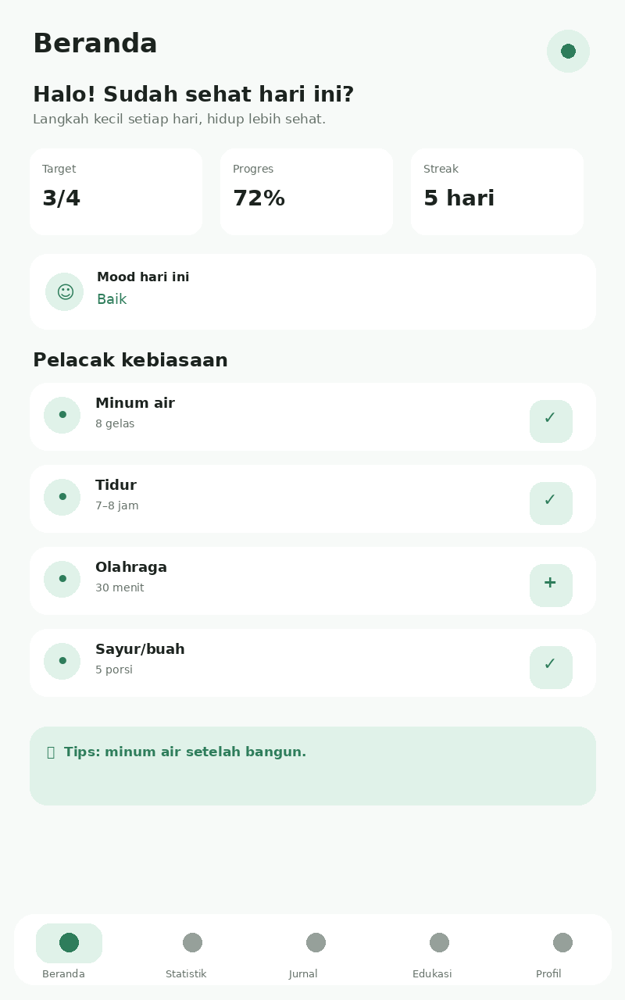
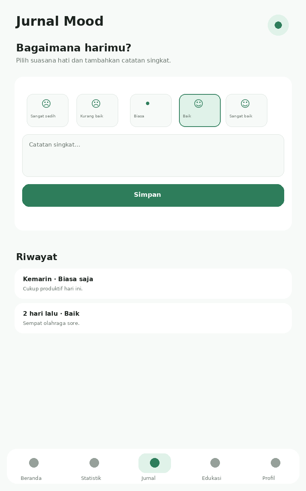
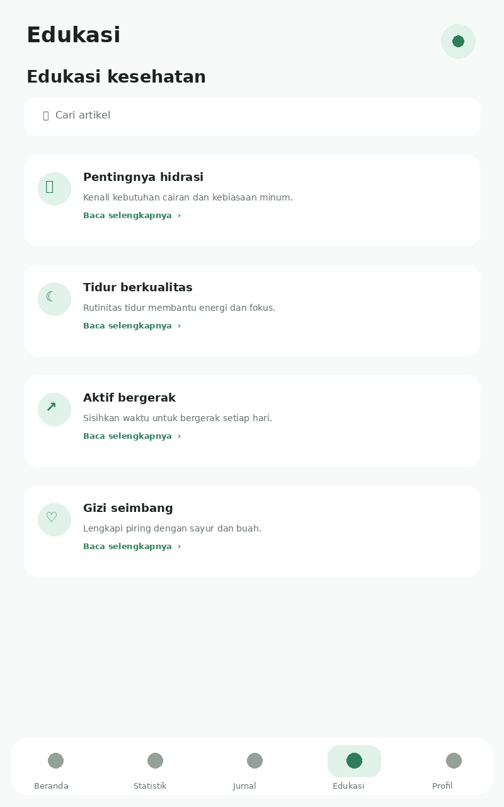

# SehatKu 🌿

**Pendamping kebiasaan sehat harian** — proyek aplikasi mobile Flutter untuk **SDG 3: Kehidupan Sehat dan Sejahtera**.

> **Kelompok:** Endless  
> **Anggota:** Wesley (241111300) dan Michael (241112834)

## 1. Ringkasan proyek

SehatKu dibuat untuk membantu pelajar, mahasiswa, dan pekerja muda membangun kebiasaan sehat secara sederhana dan konsisten. Proposal proyek mengidentifikasi empat kebiasaan utama: minum air, tidur, olahraga, serta konsumsi sayur/buah. Aplikasi juga menyediakan statistik 7 hari, jurnal suasana hati, kalkulator BMI, edukasi kesehatan, profil/pengingat, dan mode gelap.

## 2. Fitur yang sudah diimplementasikan

- Dashboard: target, progres, streak, mood, tips harian.
- Pelacak kebiasaan: air, tidur, olahraga, sayur/buah dengan tombol tambah/check.
- Statistik mingguan: ringkasan dan grafik progres 7 hari.
- Jurnal mood: pilihan suasana hati, catatan, dan riwayat.
- Kalkulator BMI: input tinggi/berat dan kategori BMI.
- Edukasi kesehatan: artikel singkat dan pencarian.
- Profil & pengingat: nama, jam pengingat, pengaturan profil.
- Mode gelap: Material Design 3 light/dark theme.
- Responsive UI: menggunakan layout Flutter yang dapat beradaptasi pada ukuran layar.

## 3. Tampilan aplikasi

Preview berikut dibuat sebagai dokumentasi tampilan halaman berdasarkan implementasi Flutter di `lib/main.dart`.

### Beranda


### Statistik


### Jurnal Mood


### Edukasi


### Profil & BMI


### Mode Gelap


## 4. Struktur project

Kode sudah dipecah menjadi beberapa file per tanggung jawab (model, tema, widget reusable, dan halaman), bukan satu `main.dart` besar.

```text
sehatku_flutter/
├── .vscode/
│   ├── launch.json        # konfigurasi Run/Debug (F5) di VS Code
│   └── extensions.json    # rekomendasi ekstensi Dart & Flutter
├── assets/
│   ├── images/
│   │   └── banner.png     # asset gambar banner Dashboard
│   └── screenshots/
├── lib/
│   ├── main.dart           # entry point: MaterialApp + pilih tema
│   ├── theme/
│   │   └── app_theme.dart  # ThemeData terang & gelap (Material Design 3)
│   ├── models/
│   │   ├── habit.dart
│   │   └── article.dart
│   ├── widgets/             # reusable widget
│   │   ├── metric_card.dart
│   │   ├── habit_tile.dart
│   │   ├── summary_row.dart
│   │   └── history_tile.dart
│   └── pages/
│       ├── main_shell.dart    # AppBar + NavigationBar + switch halaman
│       ├── dashboard_page.dart
│       ├── statistics_page.dart
│       ├── mood_page.dart
│       ├── education_page.dart
│       └── profile_page.dart
├── analysis_options.yaml
├── pubspec.yaml
└── README.md
```

## 5. Cara menjalankan

Pastikan Flutter SDK, serta ekstensi **Dart** dan **Flutter** di VS Code, sudah terpasang (VS Code akan menyarankan install otomatis lewat `.vscode/extensions.json`).

```bash
flutter pub get
```

**Lewat VS Code (Start Debugging / F5):**

1. Buka folder `sehatku_flutter` ini di VS Code.
2. Jalankan sekali `flutter create .` di terminal (di dalam folder project) agar Flutter men-generate folder platform (`android/`, `windows/`, `web/`, dsb) — langkah ini hanya perlu dilakukan sekali, dan tidak akan menimpa `lib/` atau `pubspec.yaml` yang sudah ada.
3. Pilih device di status bar pojok kanan bawah VS Code (bisa Android emulator, Windows, atau Chrome — bebas, bukan cuma Chrome).
4. Tekan **F5** (atau menu *Run and Debug* → pilih konfigurasi "SehatKu (Debug)"). VS Code akan menjalankan `lib/main.dart` lengkap dengan breakpoint dan hot reload, sama seperti `flutter run` tapi lewat UI debugger.

## 6. Catatan implementasi

Project ini sengaja menggunakan Flutter SDK dan Material 3 tanpa paket state-management eksternal. Data pada versi tugas ini bersifat **in-memory** selama aplikasi berjalan. Jika proyek dikembangkan lebih lanjut, penyimpanan lokal dapat ditambahkan untuk mempertahankan data kebiasaan, jurnal, profil, dan pengingat setelah aplikasi ditutup.

## 7. Kesesuaian dengan tugas

Implementasi menerapkan widget dasar Flutter, layout single-child dan multi-child, Material Design 3, reusable widget, asset dokumentasi, serta UI responsif. Struktur kode juga dibuat agar setiap anggota dapat menjelaskan bagian UI, state, dan logika yang dikerjakan.

## 8. GitHub

Setelah folder ini diunggah ke repository ketua kelompok, link repository dapat dikumpulkan pada assignment dosen.

Contoh perintah:

```bash
git init
git add .
git commit -m "feat: implement SehatKu Flutter project"
git branch -M main
git remote add origin <URL_REPOSITORY_GITHUB>
git push -u origin main
```

## 9. Pembagian bagian untuk presentasi/demo

- **Dashboard & tracker:** alur pencatatan kebiasaan dan progres.
- **Statistik:** grafik progres 7 hari.
- **Jurnal:** pemilihan mood dan penyimpanan catatan.
- **Edukasi:** pencarian dan detail artikel.
- **Profil:** mode gelap, pengingat, dan BMI.

## 10. Referensi sumber proyek

Spesifikasi fitur dan konsep aplikasi mengikuti proposal proyek Flutter **SehatKu**, SDG 3, Kelompok Endless.
